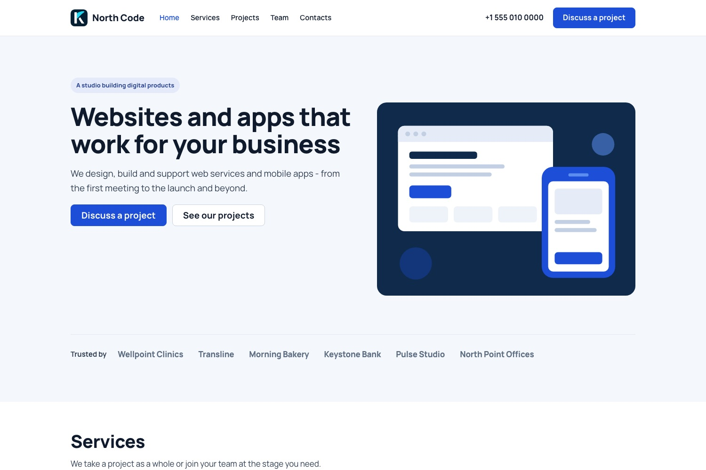
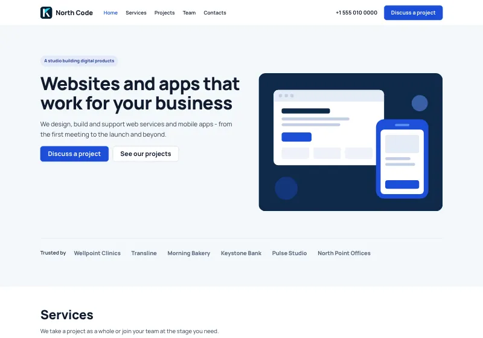
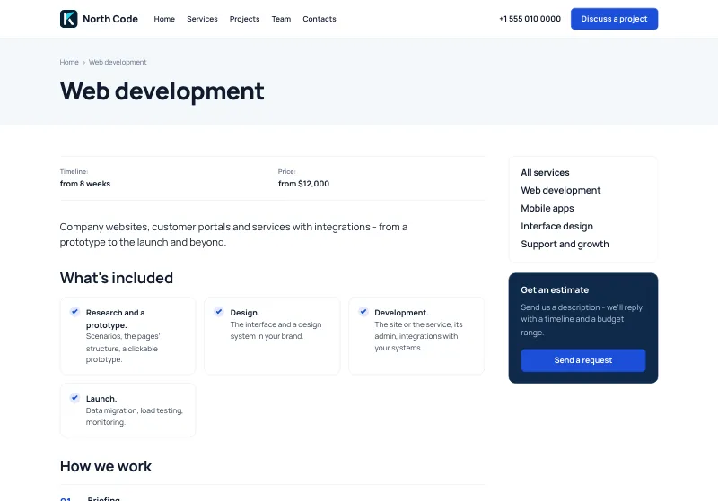
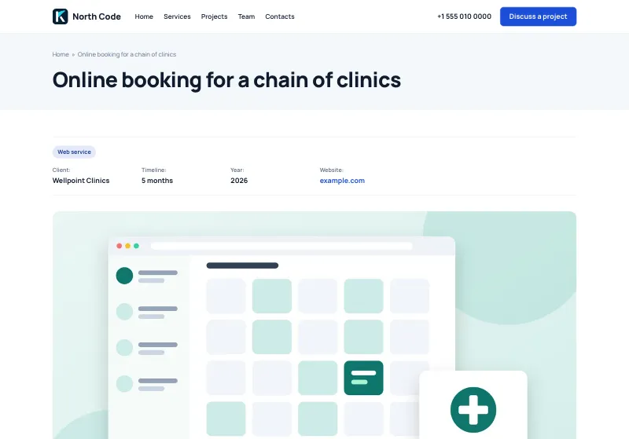
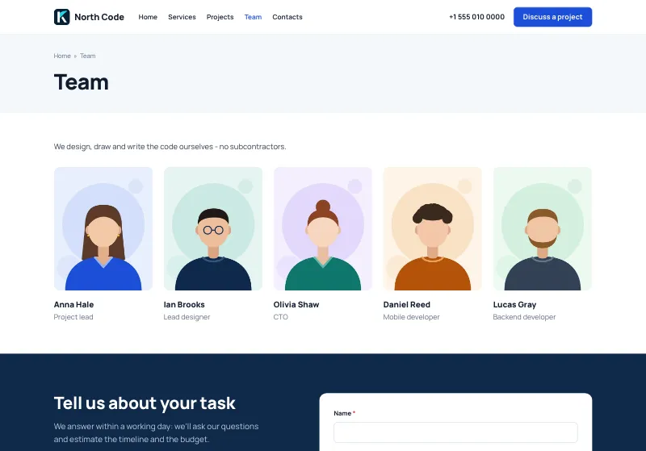
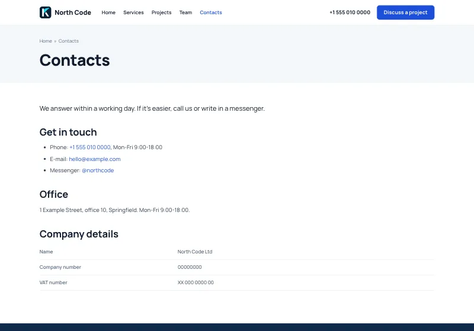
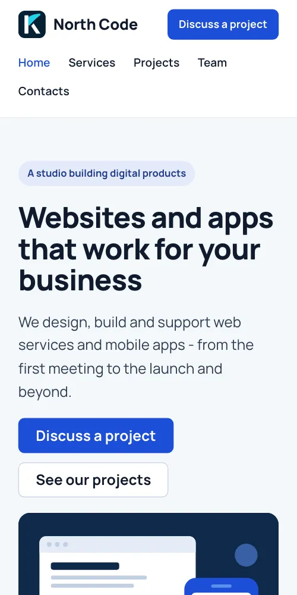
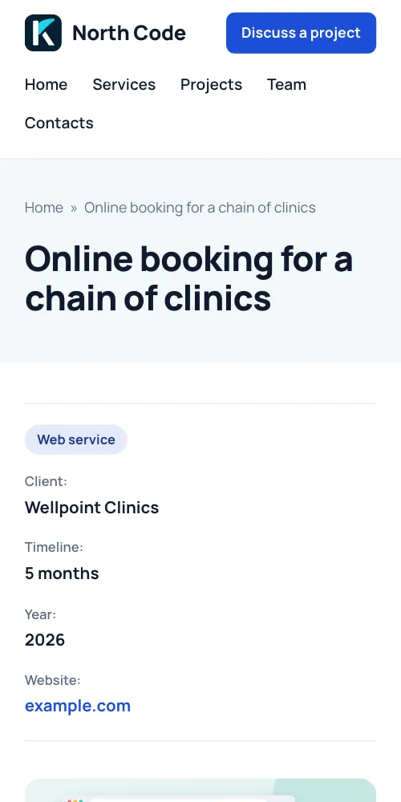

# Keel

A theme for [Kosatka](https://github.com/kosatka-cms/kosatka): a
company's site. A white header bar with the logo, the menu, a phone and
a button; a front page of full-width bands - a light hero, the content,
a dark highlight with figures, bands in white and light grey in turn,
a dark call to action with a form - each made of ordinary blocks; inner
pages with a light band over the title; a dark footer with the footer's
blocks in columns. An accent colour.



## Screenshots

The [demo site](#a-demo-site); a picture opens the whole page.

<table>
  <tr>
    <td width="50%"><a href="docs/screenshots/home.webp"></a><br>The front page</td>
    <td width="50%"><a href="docs/screenshots/service.webp"></a><br>A service</td>
  </tr>
  <tr>
    <td><a href="docs/screenshots/project.webp"></a><br>A project</td>
    <td><a href="docs/screenshots/team.webp"></a><br>The team</td>
  </tr>
  <tr>
    <td><a href="docs/screenshots/contacts.webp"></a><br>Contacts</td>
    <td><a href="docs/screenshots/phone-home.webp"></a> <a href="docs/screenshots/phone-project.webp"></a><br>On a phone: the front page, a project</td>
  </tr>
</table>

## Install

```bash
app theme add https://github.com/kosatka-cms/kosatka-theme-keel
```

Then commit `themes/` and choose *Keel* on *Appearance*. See
[Distributing a theme](https://kosatka-cms.github.io/kosatka/themes/distribute/).

## A demo site

The theme comes with a demo site in English (`demo/en.yaml`): a studio
with its services, projects, team, clients' quotes, contacts and a
request form, the front page built of the theme's bands - as on the
screenshot. The projects' and the team's pictures come with the theme
(`demo/images`). On a new site (Kosatka 0.1.6 or newer):

```bash
app install -site-name "North Code" -admin-name admin -admin-email admin@example.com \
  -language en -demo-set keel
```

Everything it creates is ordinary content, Views and blocks, changed or
deleted in the admin.

The screenshots above are of it: `python3 scripts/screenshots.py
http://127.0.0.1:8080` (the demo site's address) takes them again into
`docs/screenshots/` - Python 3 and Google Chrome are all it needs.

## Settings

On *Appearance → Keel → Settings*:

| Setting | Default |
|---|---|
| Accent colour - blue, teal, green or crimson | blue |
| Logging in and registration in the header | off |

## Regions

The engine's regions, so blocks placed for another theme stay where they
are, and the bands:

| Region | Where | What it makes of a text block |
|---|---|---|
| *Header* | the header bar | the main menu |
| *Header actions* | the header bar's end | a phone link stays a link, any other link is a button |
| *Hero* | a light band under the header | the first block's title large, its text, its links as buttons, its picture on the right; the next blocks (the clients' names, say) in a row under it; on the front page the site's slogan over it |
| *Highlight* | a dark band after the content | a list is figures: each item's bold start large |
| *Bands* | a band a block, white and light grey in turn | an ordered list is numbered steps, each item's bold start its title |
| *Call to action* | a dark band at the end | the blocks side by side: a text, a form on a white card |
| *Sidebar* | beside the content | blocks as cards; a block whose last line is one link is an offer on the dark ground, its link a button |

Use the visibility of a block (*Front page only*, *Content types*) to
keep the front page's bands there. A new site gets the copyright block
and a "Powered by Kosatka CMS" block in *Footer bottom line*; both are
ordinary blocks to change or remove on *Blocks*.

## Lists

A View's display can choose one of the theme's templates (*Theme
template*):

- `cards` - a grid of cards: the item's picture (or its number in the
  list when it has none), its terms, the title, its text's first
  paragraph, a "more" link;
- `people` - portraits with the name and the text's first line (the
  role);
- `quotes` - the item's text as a quote, its title (who said it) under
  it.

The display's text before and after the list stays around them.

## A content page

The title, the breadcrumb and the submitted line are in a light band
over the content. Fields with their labels make a row of facts; a text
list whose items open with a bold phrase becomes cards with a tick, an
ordered one numbered stages.

## Fonts

Manrope, with Latin and Cyrillic. It comes with the theme (`static/fonts`,
SIL Open Font License 1.1) and the site serves it: no requests to other
servers.

## Translations

The theme's own strings: English, Russian, German and Spanish
(`translations/`).

## License

MIT
